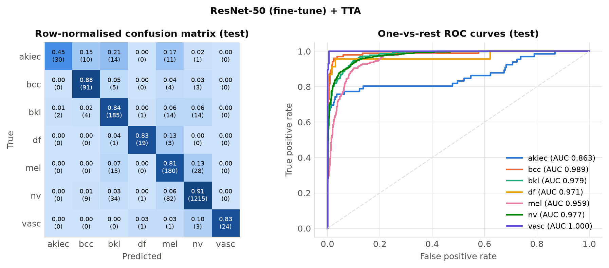
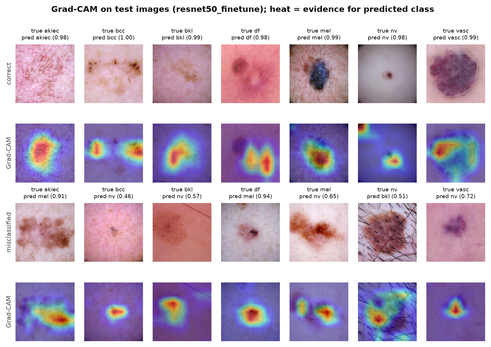

# Transfer Learning for Dermatoscopic Skin-Lesion Classification

Fine-tuning ImageNet-pretrained CNNs (ResNet-50, EfficientNet-B0) on **DermaMNIST** (HAM10000, 7 classes, 224×224).

**Deep Learning, M.Sc. in CSE, Daffodil International University, Fall 2026**
**Group Assignment 1 (CT-1), Task 2: CNN / Transfer Learning / Fine-tuning**

| Member | Student ID |
|---|---|
| Shakib Howlader | 262-25-013 |

📄 **Report (PDF):** [`report/main.pdf`](report/main.pdf)

---

## Highlights

- **Final model:** ResNet-50, full fine-tuning with discriminative learning rates, 8-view test-time augmentation. It was selected on the validation split only.
- **Test results:** **87.0% accuracy**, **79.2% balanced accuracy**, **80.1% macro-F1** (95% CI [76.6, 83.0]) and **macro-AUC 0.962** on the 2,005 held-out images. That is about 10 accuracy points above the official MedMNIST v2 baselines.
- **Transfer learning is decisive:** macro-F1 goes from 48.0% (CNN trained from scratch) to 55.9% (frozen ResNet-50) to 77.2% (full fine-tuning).
- **Rigorous evaluation:** bootstrap confidence intervals, per-class metrics, calibration (ECE), Grad-CAM, t-SNE, and an audit of near-duplicates between the train and test splits.

### All runs (test set, single view)

| Run | Acc. (%) | Bal. acc. (%) | Macro-F1 (%) [95% CI] | Macro-AUC | ECE |
|---|---|---|---|---|---|
| SimpleCNN (scratch) | 73.6 | 49.4 | 48.0 [44.6, 51.0] | 0.908 | 0.163 |
| ResNet-50 (frozen) | 76.5 | 56.6 | 55.9 [51.3, 60.3] | 0.920 | 0.198 |
| EfficientNet-B0 (frozen) | 75.3 | 63.5 | 59.4 [55.2, 63.0] | 0.929 | 0.171 |
| **ResNet-50 (fine-tune)** | **86.1** | **76.3** | **77.2 [73.4, 80.5]** | **0.955** | **0.084** |
| ResNet-50 (gradual unfreeze) | 83.0 | 74.1 | 73.2 [69.3, 76.4] | 0.958 | 0.133 |
| EfficientNet-B0 (fine-tune) | 84.8 | 76.0 | 72.9 [69.0, 76.3] | 0.959 | 0.103 |
| ResNet-50 (fine-tune, unweighted CE) | 86.9 | 71.8 | 75.7 [71.7, 79.4] | 0.971 | 0.024 |

<p align="center">
  
</p>
<p align="center">
  
</p>

## Repository layout

```
src/
  common.py          paths, class names, memory-mapped Dataset, augmentation, class weights
  prepare_data.py    MD5-checked .npz -> per-split .npy conversion
  eda.py             data analysis, figures, duplicate/leakage audit
  models.py          SimpleCNN, ResNet-50, EfficientNet-B0, stage split, embeddings
  train.py           scratch / frozen / finetune / gradual training with model selection
  metrics.py         accuracy, balanced accuracy, macro-F1, AUC, ECE, bootstrap CIs
  evaluate.py        test evaluation with and without 8-view TTA
  make_figures.py    comparison figures and LaTeX tables
  gradcam.py         Grad-CAM and t-SNE for the selected model
  report_numbers.py  every number quoted in the report, as LaTeX macros
  plot_style.py      shared colour-blind-safe figure style
scripts/run_all.sh   reproduces every experiment, table and figure
results/             eda.json, summary.json, runs/<name>/{config,history,eval,probs}, figures/, logs/
report/              LaTeX source + compiled PDF
```

## Reproduce

Requires an NVIDIA GPU with at least 4 GB of memory. The full run takes about 70 min on a GTX 1660 SUPER.

```bash
git clone https://github.com/mr-shakib/dermamnist-transfer-learning.git
cd dermamnist-transfer-learning
python3.12 -m venv .venv
.venv/bin/pip install torch torchvision --index-url https://download.pytorch.org/whl/cu126
.venv/bin/pip install -r requirements.txt
bash scripts/run_all.sh          # downloads the data (1.09 GB, MD5-checked), trains, evaluates, plots
cd report && latexmk -pdf main.tex
```

Individual steps, e.g. one experiment:

```bash
.venv/bin/python src/train.py --name resnet50_finetune --arch resnet50 --strategy finetune --epochs 12
.venv/bin/python src/evaluate.py --runs resnet50_finetune
```

> **Note on mixed precision:** training runs in FP32 by default. On GTX 16-series GPUs, which have no tensor cores, FP16 autocast measured 3.3× *slower*. Pass `--amp` on tensor-core GPUs.

## Data

DermaMNIST from [MedMNIST+](https://zenodo.org/records/10519652) (Yang et al., *Scientific Data* 2023; Doerrich et al., *Scientific Reports* 2025). It is derived from HAM10000 (Tschandl et al., *Scientific Data* 2018) and licensed **CC BY-NC 4.0**. The dataset and model checkpoints are not stored in this repository; `scripts/run_all.sh` downloads and regenerates them.

This is a course project, not a medical device.
